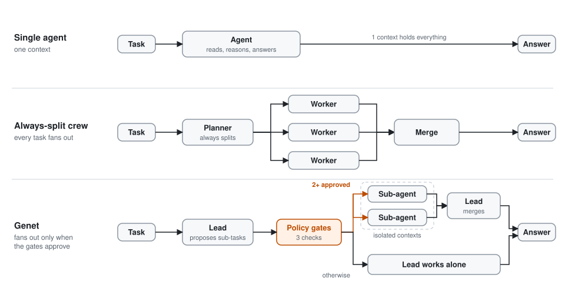
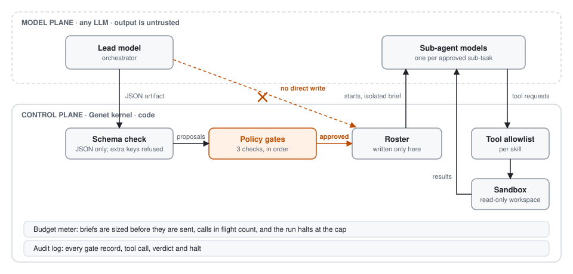
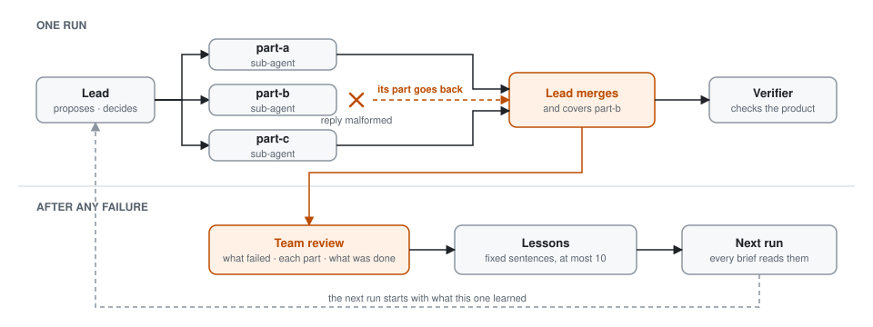
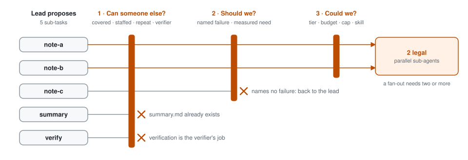

# Genet

[Apache-2.0](LICENSE) · Python 3.11+ · kernel, not a cloud · [Website](https://jrodriguez4505.github.io/Genet/)

One organism. Many stems.

**The question is not how many agents you can run. It is whether a second one is doing new work.**

Genet is a small multi-agent runtime. Agent counts have become a headline number, with products advertising hundreds of sub-agents on one task, but a count says what was spent, not what was gained. Most stacks treat headcount as capacity; Genet treats it as a cost. A task starts with one lead agent (the orchestrator). The lead may propose sub-agents, each with the skill its sub-task needs, and policy gates in code decide whether any of them run. Default is a single agent. Authority lives in the graph, not in the prompt.

<picture>
  <source media="(prefers-color-scheme: dark)" srcset="docs/img/patterns-dark.svg">
  
</picture>

*Same task, three ways to staff it. A crew fans out on every task. Genet's lead proposes, and the gates decide whether a fan-out happens at all.*

The team is small, and every agent can switch skills, with specialists added only when a sub-task needs one. The lead owns the roster. The goal stays fixed while the method changes. Work fans out to sub-agents only when the task has independent parts, then merges back.

Quality of process over quantity of agents: possibly more efficient, and possibly more effective. That stays a claim until measured. `taskorg compare` exists to measure it (see [Proving it](#proving-it)).

## The team

Genet is built for a small, cohesive team:

- The lead knows what each member can do.
- Members differ where it matters: in what they see, what they may open, and which model fills them. They do not differ by a persona in the prompt.
- Everyone works from the same goal, purpose and done-when.
- Responsibility is shared. Decisions and the outcome are the lead's.

Every agent is the same model and could hold any skill. So a member is a position, not a kind of agent, and authority belongs to the position. Each member the team adds must do work the others could not.

Built so far: an independent verifier, shown sources the kernel picks (see [Verification](#verification)). Designed, not built:
- a lead that knows its members, from a record the kernel keeps;
- teams that nest under the same gates;
- a lead that can be replaced from the record.

The design is in [docs/TEAM_DESIGN.md](docs/TEAM_DESIGN.md), and [ARCHITECTURE.md](ARCHITECTURE.md) maps the code.

## What it refuses

- Org-chart roleplay as architecture
- Workers that spawn workers
- `could we` as the first question
- Staying on a dead plan because the team looks aligned
- Unbounded loops

## Who decides what

<picture>
  <source media="(prefers-color-scheme: dark)" srcset="docs/img/control-dark.svg">
  
</picture>

*Models propose; code disposes. Nothing a model writes reaches the roster, the tools or the budget without passing a check in code, and every decision lands in the audit log.*

Models only fill a fixed JSON artifact: `claim`, `evidence`, `uncertainty`, `channel_id`, `context_update`, `requests`. Any other key is rejected. The lead proposes sub-agents as `requests` entries like `subtask:<channel>@<skill>=<named_failure>`. It cannot write the roster.

A run has four steps:

1. **Read and propose.** The lead reads the context and proposes sub-tasks, or none.
2. **Judge.** The gates decide. Two or more legal sub-tasks run as parallel sub-agents, each blind to the others, and the lead merges their results. A sub-agent that fails hands its part back to the lead. Otherwise a single agent does the work, switching to whatever skill the job needs.
3. **Verify.** If the product fails and the budget tier allows, the lead requests a replan, changes the method and reworks once.
4. **Answer from the record.** The operator's question is answered from the gate record, and the run closes. A closed run is read-only. If anything failed, the kernel's review is the last entry on the record.

## Shared ownership

<picture>
  <source media="(prefers-color-scheme: dark)" srcset="docs/img/ownership-dark.svg">
  
</picture>

*A failed part is not lost, and a failure is not wasted. Authority violations, budget halts and crashes still stop the run at once.*

The lead makes every decision; the outcome is the team's. When something goes wrong, the run does not single out an agent and stop. The team absorbs what it can, and records what happened so the next run starts better.

- **A failed part goes back to the team.** When a sub-agent's reply is malformed (`SCHEMA`) or its call to the model fails (`LIVE`), the run goes on. The other sub-agents' results are merged, and the lead covers the failed part the same way it covers a part the gates refused. An authority violation, such as a tool the skill does not allow or a roster change, still stops the run at once, as do a budget halt and a crash.
- **A blameless review after every failure.** When anything failed, even if the team recovered, the kernel writes a review on the run: what failed, what became of each part, and what the team did about it. It is built from the record, never from model text, and it names no agent as the cause.
- **Lessons for the next run.** Each kind of failure maps to one fixed lesson, which goes into `guidelines/lessons.md` in the store. Every agent's brief carries the guidelines, so the next run starts with what the last one learned. Repeats are counted, at most 10 lessons are kept, and `--no-lessons` turns it off. Comparison trials each use a fresh store, so no lesson carries from one strategy to another.

Decisions stay with one owner because shared authority is no authority: the roster, the gates and the budget answer to the lead and the kernel alone. What is shared is responsibility for the result.

## Gates

Every proposed sub-task goes through three gates in order, and they fail closed: **can someone else → should we → could we.** In industry terms this is admission control for sub-agents. Each proposal gets a full gate record, legal or not.

<picture>
  <source media="(prefers-color-scheme: dark)" srcset="docs/img/gates-dark.svg">
  
</picture>

*Refused work is either already covered or goes back to the lead; it is never silently dropped.*

| Gate | Refuses a sub-task when |
|---|---|
| Can someone else | A file or channel in the world already covers it, the channel is already staffed, it repeats another proposal, or it is verification (the verifier's job). A single open sub-task is the lead's job, not a new agent's. |
| Should we | It names no failure: what goes wrong if a single agent does it. Then, for the team: there is no measurable reason a single agent would fail. A fan-out needs one of two reasons: the operator declared that the sub-tasks must stay isolated (`--isolate`), or their material does not fit in one call. The room in one call is the per-call limit less what the lead's own planning call cost, brief and reply. Material is estimated from the sizes of the workspace files each sub-task covers. A file several sub-tasks need counts once, and a split that leaves one sub-agent carrying all of the material is not a reason. If the material can't be measured, it doesn't count as a reason. |
| Could we | Its skill is unknown, or its channel id is unusable or reserved. The budget tier does not allow a fan-out. The budget cannot pay for the sub-agents plus merge and verify. The cap of 4 workers is full. |

A fan-out needs at least two legal sub-tasks.

That second check makes the gate measurable rather than rhetorical. The lead can no longer split work just by giving a reason. `--split-policy stated` restores the old behavior, where the lead's named reasons are enough; it is kept for comparison. Fan-outs the operator names with the `fanout` command count as declared.

When the plan no longer fits, request a replan and change the method. `KEEP_ROSTER` is illegal on a replan request; use `CHANGE_METHOD` or `REVISE_GOAL`.

## Skills and tools

Every slot carries one active skill. The lead can switch its own. A sub-agent is created with the skill its sub-task names, which makes it a specialist. Each skill has its own brief and tool allowlist, and can have its own model.

| Skill | Tools | Brief |
|---|---|---|
| `execute` | — | Do the assigned piece of work. |
| `retrieve` | `retrieve`, `read` | Find source material; cite paths and lines. |
| `observe` | `observe`, `read` | Survey what exists. |
| `reason` | — | Work the problem through. |
| `draft` | — | Write the product. |
| `simulate` | — | Run the plan forward; report where it breaks. |
| `verify` | — | Judge the product: PASS or FAIL. |

The tools only read: `read:<path>`, `retrieve:<query>` and `observe[:<dir>]`. They reach only the `--workspace` directories and the `--read` files. Hidden files (anything whose name or folder starts with a dot, such as `.env` or `.git/`), binaries, and symlinks that lead outside the workspace or into a hidden file are refused. A file you attach with `--read` is readable even if hidden, because you named it. The allowlist is checked before any tool runs, and each tool round is a budgeted call (at most 2 rounds per sub-agent).

## Budget tiers

| Tier | Flag | Allowed | Cap |
|---|---|---|---|
| Tight | `--tier tight` | single agent | 4 calls / 4k tokens / 30s |
| Normal | `--tier normal` | + replan | 8 / 15k / 60s |
| Open | `--tier open` | + gated fan-out | 12 / 50k / 120s |

The CLI defaults to tight. Do not raise the budget because the model sounded ready. A run may spend its whole budget, but not one call more.

## Install

```bash
git clone https://github.com/jrodriguez4505/Genet.git
cd Genet
python3 -m venv .venv && . .venv/bin/activate
pip install -e ".[dev]"
pytest -q
```

## Commands

```bash
# The lead staffs the task.
python -m taskorg.cli run --context "One paragraph holds everything needed."

# Two notes. If they fit one context, the gates keep a single agent and say why.
# --isolate declares they must not share a context, so the gates allow a fan-out.
python -m taskorg.cli run --tier open --workspace notes/ \
  --context "subtask:note-a@retrieve=sources_must_not_mix subtask:note-b@retrieve=sources_must_not_mix"
python -m taskorg.cli run --tier open --workspace notes/ --isolate \
  --context "subtask:note-a@retrieve=sources_must_not_mix subtask:note-b@retrieve=sources_must_not_mix"

# Fixed paths: the operator picks the shape.
python -m taskorg.cli single --tier tight
python -m taskorg.cli replan --tier normal
python -m taskorg.cli fanout --tier open --context "subtask:source-a=independent_a subtask:source-b=independent_b"

# Read a saved run.
python -m taskorg.cli diagnose data/runs/run-001.json
python -m taskorg.cli board data/runs/run-001.json
python -m taskorg.cli bench
```

Every run command takes these flags:

- `--goal`, `--purpose`, `--done-when` and `--context`: what the run is for, and what is known.
- `--read FILE`: file text goes into working memory.
- `--workspace DIR`: specialists may read and search here.
- `--exists FILE`: the file's name covers a channel.
- `--criteria TEXT`: the product must show this.
- `--isolate`: the sub-tasks must not share a context, which is a declared reason to fan out.
- `--split-policy measured|stated`: what "should we" accepts (default `measured`).
- `--tier`, plus budget overrides: `--max-calls`, `--max-tokens`, `--max-seconds`, `--max-tokens-per-call`.

Each run starts with clean working memory, even when you reuse a run id. Runs saved before the 0.2 rename still load.

`bench` scores every fixture in `fixtures/bench/` against its `expect` block.

## Proving it

`compare` runs the same tasks three ways. Model, tools, budget, tool rounds, verify-and-replan step and concurrency are all the same; only how the task is staffed differs. A part that gets no sub-agent, for the worker cap or a malformed id, goes back to the lead under every strategy.

| Strategy | Staffing |
|---|---|
| `single` | One agent works the task. No planning call. |
| `always` | Crew style: the lead always decomposes, and every sub-task gets a worker, up to the cap. |
| `genet` | The lead proposes sub-agents and the gates judge them, with the measured "should we". |
| `genet-stated` | Same, but the lead's stated reasons are enough. Add it with `--strategies single,always,genet,genet-stated`. |

The tasks come from a seeded, synthetic corpus of company operating notes, so ground truth is exact and no model has seen it. Facts are written in varied prose and surrounded by distractors: prior-year figures and look-alike company names.

A product is graded on its last `ANSWER:` marker, in capitals; an "answer:" in prose does not count. A number must be the line's one value: period labels such as Q3 or FY2026 are ignored, `a + b = c` answers `c`, and a range or a list is not an answer.

| Family | Question | Stresses |
|---|---|---|
| `lookup` | One figure for one company | One source holds everything needed |
| `aggregate` | Sum of a figure over 3 companies | Independent parts |
| `compare` | Which of a look-alike pair had higher churn | Interference |
| `breadth` | Which of 5 companies had the highest revenue | Many sources |

The claim under test: genet matches the better baseline's accuracy at close to single-agent cost. The report shows accuracy, tokens, calls, latency, split rate and aborts, overall and per family, plus cost when you give prices.

Three options test the concept itself, each off by default so the default suite never changes: `--entities N` asks aggregate and breadth questions over N companies, from a pool of 38 with 12 look-alike pairs; `--distractors N` adds N wrong-year figures to each company's notes, phrased like the real ones; and `--filed N` gives N of each question's companies already filed and checked, in the task's context, and marks them covered, so a sub-agent for one of them would repeat finished work. `scripts/concept_runs.sh` runs both arms on Claude with one key entry, a cap and a tape per run.

`verify-bench` measures the verifier on its own. Real runs give too few wrong products to count catches, so it builds them:
- four products for each aggregate question, the way a lead's product reads;
- one right, one right with other evidence, one with a company's figure taken from its look-alike's file, and one with the FY2025 figure;
- each with the record its author would have left.

The arithmetic always adds up, so it never gives an error away. Each product is reviewed under five setups:
- `today`;
- `shared-full` and `shared-layered`;
- `independent-full` and `independent-layered`.

The report shows wrong products caught (by kind), how many of those FAILs name the planted company, right products failed, how often the company's own file was among the sources, and tokens a review. `scripts/verify_runs.sh` runs it on Claude Haiku 5.5, capped and taped. On the simulated reader, a perfect checker of what it is shown, `full` catches every planted error, `layered` every look-alike one, and `today` none. On Haiku 5.5, `today` caught 2 of 12, `full` 12 of 12 in either view, and `layered` 9 of 12 for the right reason in either view. No setup failed a right product.

```bash
python -m taskorg.cli verify-bench                          # simulated reader, 120 reviews, $0
python -m taskorg.cli compare --dry-run                     # the plan and call ceiling; calls no model
python -m taskorg.cli compare --adapter sim                 # deterministic reader: structural cost at $0
python -m taskorg.cli compare --adapter live --per-family 2 # pilot: 24 trials
python -m taskorg.cli compare --adapter live --price-in 2 --price-out 10   # full: 60 trials, with cost
```

The `sim` adapter is a deterministic reader, not a language model. It solves every task under every strategy, which shows the harness gives each strategy the facts it needs. Its token counts show what each strategy costs by structure alone. With a perfect reader, splitting rarely pays: a single agent is cheapest in every family of the default suite. Splitting can only earn its accuracy if a real model reads worse with everything in one context; the concept experiments measured that on Claude Haiku 5.5, below.

What the simulated reader shows. These are structural results from a perfect reader, not model results:

| Per-call context | Single agent | Always-split crew | Genet |
|---|---|---|---|
| Roomy, `--context 16000` | 100% · 2,880 tokens/task | 100% · 5,100 | 100% · 3,455 (1.20× single) |
| Tight, `--context 1500` | **55%**: runs abort on context overflow | 100% · 5,020 | 100% · 4,594 (0.92× crew) |

The counts include the files the verifier is given, the default since v0.7.0. With `--verify-sources none` they are as before: 2,068, 4,288 and 2,643 (1.28×) roomy, and 4,288 and 3,862 (0.90×) tight.

When the work fits one context, Genet stays a single agent and pays only for its planning call. When it doesn't fit, a single agent fails, and Genet fans out exactly where the material requires it. Per family at `--context 1500`, Genet stays a single agent on lookup and compare, where a single agent scores 100%, and fans out on aggregate and breadth, where it scores 20% and 0%. At 20 companies a question, the simulated single agent costs 1.5 times the crew: it re-sends everything it has read every round.

The stub adapter drives the harness end to end but cannot answer, so its accuracy is 0 by design. Results are saved to `data/compare/` as JSON.

### What the live runs show

Every live run so far is on Claude, recorded in [docs/LIVE_TESTS.md](docs/LIVE_TESTS.md) with tapes that replay it at no cost.

- **One agent was enough, and was the most accurate.** On the default questions, with every fix, single, crew and Genet each got every answer on Haiku 5.5, and Sonnet 5.5 did too at eleven times the cost. Asked about 5, 10 and 20 companies at once, about 84,000 tokens a task at the largest, a single agent still got every answer. On this model and these tasks there was no loss for a split to recover, so splitting for quality is not shown.
- **Headcount cost accuracy.** The always-split crew went from 8 of 8 to 5 of 8 and 5 of 7 as the questions grew, losing answers in hand-offs and merges. It cost 1.8 to 2.5 times a single agent on small questions; past about 10 companies it cost less, but about the same per right answer.
- **Genet stayed one agent wherever the work fit,** at 1.2 to 1.6 times a single agent's tokens: its planning call, which on a real model costs about as much as a working call. With half of each question's companies already filed, it was the cheapest strategy of all. Haiku's crew lead left filed work out of its plan by itself, so Genet's first gate had nothing to refuse.
- **A verifier catches what it is shown.** Without sources, Haiku's verifier passed 10 of 12 planted errors, catching only the two whose own evidence quoted the wrong year. Given every file, it caught all 12 and failed none of 12 right products, at about six times a review's tokens. The layered pick caught every look-alike error at 1.6 times. Leaving out the author's notes made no measurable difference.
- **Judging fit before the work is unreliable.** At a tight cap, the lead told the limit still judged work too big for one call to fit, and the gates' estimate from file sizes ran short, because searches pull in look-alike files.

On this evidence, Genet's value is governance and cost: it stays one agent when one is enough, which here was always, and keeps the decision to split in code. Accuracy gains from splitting are not shown. The live runs found 14 problems the simulated reader could not show, among them sub-agents that read their siblings' files, a verifier shown a stale product, a harness example that primed a look-alike mix-up, and a verifier that passed a wrong total because it could not open a source. Thirteen are fixed: the verifier now gets the riskiest sources by default, and on Haiku 5.5 it caught every planted error whose file it was shown. Judging fit before the work starts is open.

## Live model (optional)

Any OpenAI-compatible chat endpoint:

```bash
export TASKORG_MODEL_BASE=https://api.x.ai/v1
export TASKORG_MODEL_KEY=...
export TASKORG_MODEL_NAME=...                 # required
export TASKORG_MODEL_NAME_REASON=...          # optional: a model per skill
python -m taskorg.cli run --adapter live --tier normal --context "..."
```

The base URL must be `https://`, or `http://` to this machine (a local model server). Plain `http://` to any other host would send the key in clear text, so it is refused unless you set `TASKORG_MODEL_ALLOW_HTTP=1`, for example for a server on your own network. Redirects are never followed, so the key reaches only the host you named.

Every request asks the endpoint to stop the reply at what is left of the per-call cap, in the `max_tokens` field, so a reply that runs on is never billed past it. Set `TASKORG_MODEL_MAX_TOKENS_PARAM=max_completion_tokens` for an API that names the field that way, or `none` to send no cap. When an endpoint reports no token usage, the adapter estimates it from the exact request it sent and the raw reply it got, and marks the call `tokens_estimated`.

### Claude, through the Messages API

```bash
pip install -e '.[anthropic]'                 # the official SDK; Genet itself needs nothing
export TASKORG_ANTHROPIC_KEY=...
export TASKORG_MODEL_NAME=claude-haiku-5-5
export TASKORG_MODEL_EFFORT=low               # optional: low, medium, high, xhigh or max
python -m taskorg.cli compare --adapter anthropic --per-family 1 --price-in 0.10 --price-out 0.50 --max-spend 0.50
```

Same prompts, the same JSON gate and the same token accounting as the live adapter; only the transport differs. The key is read from `TASKORG_ANTHROPIC_KEY` and nowhere else, so a key exported for another tool is never spent by accident, and an endpoint set for the live adapter never receives it. Requests carry no temperature, which current Claude models reject, and the reply cap is what is left of the per-call cap. Thinking tokens are billed as output: they count in each call's completion tokens, and the tape records them on their own. A refused request fails as `LIVE`, so its part goes to the lead. The SDK retries overloads and rate limits itself, and follows no redirect. `bash scripts/live_pilot.sh` runs the pilot with a smoke test first, a cap per model and a tape.

### Spend cap and tapes

`--max-spend` stops a comparison before a trial that could take spending past the cap, judged by the costliest trial so far. Ctrl-C also stops it. Either way the trials already run are saved.

`--record PATH` saves every exchange with the model as it happens: the request, the reply text and its usage, or the error. Never the key, never the base URL. `--replay PATH` answers from that tape instead of a model, with no key and no spend, so the kernel, the gates and the grading can be refined against real replies. A request the tape does not have, because a prompt or brief changed since the recording, fails as `LIVE` and is counted. A tape recorded before v0.7.0 replays with `--verify-sources none`, the verifier's brief at the time. Tool results name files relative to the workspace, so the same request reads the same on every run, and no temp folder or home directory reaches the model.

## Security

Genet treats three things as untrusted input: what the model endpoint sends back, what the model asks for, and what is in the workspace. A planted instruction in a workspace file is assumed to reach the model, so the limits are enforced in code, not in the prompt:

| Limit | Value | What it stops |
|---|---|---|
| Response size from the endpoint | 8 MB | A reply that exhausts memory |
| Time for the whole exchange: connect, headers, body | the timeout | A server that sends a byte at a time to hold a run open |
| Brief size plus room for the reply, checked before sending, counting the system prompt and wrapping | the per-call token cap | A request that is sent, paid for, and then overruns |
| Tools run per reply | 8, repeats once | One reply that triggers thousands of reads |
| Sub-tasks the gates judge per plan | 16 | A proposal flood |
| Text one search scans | 20M characters | A search that reads an entire disk |
| Terms one search matches | 16 | A query that makes one search take hours |
| Entries one walk looks at | 20,000 | A huge or hostile directory tree |
| Reported token counts | whole numbers, not negative | A reply that hides its own spend |
| Calls in flight | counted against the budget | Parallel sub-agents that each spend past the cap |
| Reply length, asked of the endpoint | what is left of the per-call cap | A reply that runs on and is billed |
| Spend per comparison | `--max-spend` | A run that drains the account |
| Where the Claude key comes from | `TASKORG_ANTHROPIC_KEY` only | A key exported for another tool, spent by accident |

A malformed reply is asked again once, with a note saying what was wrong; models slip on the format now and then, and a retry is cheaper than losing the run or the part. Only a malformed reply is retried, never an authority violation, and the retry is a budgeted call like any other. The room kept for a reply is the largest reply in the run so far, and 200 tokens for a live model before it has replied; the gates count the same room when they decide what fits. A call that fails after it was sent, for example on malformed JSON, stays on the record marked `failed`: it counts toward the budget and toward every cost the comparison reports. Saved runs, working memory and results are written atomically, so a crash mid-save leaves the previous file, never a truncated one. An answered review note is a record and cannot be answered again; a deferred one can.

When one sub-agent fails, or you press Ctrl-C, the run closes at once and the sub-agents still running start no further calls. Any other failure inside a run, not only a rule the kernel enforces, leaves it aborted with a reason, and the CLI saves it as `CRASH`. A request string from a model, such as a path with a NUL byte or a symlink loop, comes back as "not found" instead of stopping the run.

Malformed JSON from the endpoint or the model, including nesting too deep and numbers too long to convert, stops the call as a `LIVE` or `SCHEMA` error. A malformed saved run is refused as `PERSIST`, and a saved run cannot give a slot tools its skill does not allow. See [SECURITY.md](SECURITY.md) to report a vulnerability.

## Verification

The verifier's verdict is the first word of its claim: PASS passes, and anything else fails, so "Passing this would be wrong" is not a pass. A live verifier is told to pass a product only if it answers the goal, its subject and its question, and to fail one about something else even when it repeats the criteria: a past live run passed an answer about Jean Genet the playwright on a task about this kernel. Then every success criterion must appear in the product itself, as a whole word or number ("4.1" is not met by "14.1"): its claim, evidence or context update. The verifier's own evidence does not count, so it cannot pass a product by echoing the criteria. These run-state checks must also hold:

- The context and the method are not empty.
- Sub-agents merged their results.
- No review is open.

Name the criteria with `--criteria`. The defaults, "default task" and "purpose", are met by any reply that echoes its brief, so a run verified only against them carries the warning `verified_against_default_criteria` in `diagnose` and in the CLI's output. The comparison does not depend on this: it grades every answer against known ground truth.

The verifier always gets its call. When a split is judged, the gates reserve the merge, including the tool rounds it needs to cover a part no sub-agent took, and the verify call. A single agent's work and a rework stop their tool rounds in time to leave that call.

### What the verifier checks against

The verifier sees:
- the product;
- up to 12 of its evidence lines;
- the shared context, which carries every member's notes;
- the workspace files the kernel opens for it, by default the riskiest few.

It has no tools of its own. On 28 October, before the kernel opened files for it, that let a wrong total through: the verifier could not open a source, and it read the author's own note that look-alike files were excluded. Two settings decide what it sees. Run commands, `compare` and `verify-bench` all take them:

| Flag | Values | What it does |
|---|---|---|
| `--verify-view` | `shared` (default), `independent` | `independent` leaves out the author's notes. The verifier gets the context as the operator gave it, the goal, the criteria, and the product with its evidence, and none of working memory's product or sub-agent reports. |
| `--verify-sources` | `layered` (default), `full`, `none` | The kernel opens workspace files and puts them in the verifier's brief. See below. `none` opens nothing. |

What each mode opens:
- **`full`:** every file the goal names, the product cites or its uncertainty names, or the run read.
- **`layered`:** first, any file the goal names that no call in the run read or searched. The product has something for that subject, so it came from somewhere else. Then the files the product's uncertainty names. Then two at random from what the goal names or the product cites.

The kernel picks the files from the run's record and the product's text. The author does not pick them, and neither does the verifier. Files go in up to the per-call limit, and the brief says how many did not fit. The record holds every pick and why, so the same product opens the same files and a tape replays.

With sources on, the kernel also checks, in code, that every evidence quote is in a file its evidence line cites, and tells the verifier which are not. A file named inside the quote does not count as cited. Quotes of the tool's own words, of a search query, or of a member's report are not checked. Over all 885 products on the Claude tapes, it flags 6, and each is a quote the cited files do not hold. The verdict stays the verifier's, and the criteria checks above still apply.

`layered` became the default after its live run (29 October, [docs/LIVE_TESTS.md](docs/LIVE_TESTS.md)). It caught every look-alike error at about 3% more tokens on a 20-company task, where `full` caught every planted error at about a quarter more. A run with no workspace has nothing to open, so its verifier's request is unchanged. `--verify-sources none` sends the verifier's request as it was before v0.7.0, which tapes recorded before then need to replay.

## Diagnose

`diagnose` reports health, the budget used and remaining, and every gate verdict and tool call. It shows what became of each part under `team`, and the run's review when anything failed. It also reports isolation: whether any sub-agent's brief carried another sub-agent's result. That is checked at call time over the whole brief, and the verdict survives save and load.

These count as fails:

- A tight-tier run that grew the roster.
- A normal-tier run that answers a replan request with `KEEP_ROSTER`.
- Any run with `isolation_leak`.
- Any aborted run, and any run whose stop rule failed.

Runs saved before isolation was recorded show `isolation_unverified`.

## Tests

`pytest -q` runs about 1,490 checks with no network and no key:

- **Kernel rules and regressions.** Each rule, and each bug fixed so far, has a test that fails if it comes back.
- **Red team.** Hostile model output must be refused, contained or halted: authority keys, spawn requests, path escapes, instructions planted in workspace documents, channel spoofing, proposal floods, oversized output.
- **Fuzzing.** 300 random sequences of 40 calls from random actors. The roster rules hold after every call.
- **Concurrency.** Parallel sub-agents never lose, double-count or cross results, and a tight budget is never overspent.
- **Live adapter.** Driven against a fake OpenAI-compatible endpoint: prompts, usage accounting, HTTP errors, timeouts.
- **Security.** One test per attack on the trust boundaries: redirects that would carry the key, plain-HTTP endpoints, oversized and slow responses, malformed JSON, fake token counts, oversized briefs, tool floods, hidden files and symlinks to them, huge trees, and tampered saved runs.
- **Review findings.** `tests/test_hardening.py` has one test per finding from a review of concurrency, input handling, persistence, the CLI and decision logic: siblings that kept spending after a failure, parallel overspend, unpaid merges, verdicts read by substring, crew parts dropped silently, grading by first number, hostile request strings, dripped headers, typed run files, and more.
- **Shared ownership.** `tests/test_ownership.py`: a failed part goes back to the lead and the run goes on; authority violations, budget halts and crashes still stop it; every failure is reviewed; lessons reach the next run, never carry model text, are counted and bounded, and can be turned off; and a review never changes a run's outcome.
- **Bounds.** `tests/test_bounds.py` runs 400 seeded runs against a hostile stand-in model that floods tools and proposals, sends malformed replies, fails calls, breaks authority rules and reports random, missing or invalid token counts. Every run must end without leaving a thread, stay within `max_calls`, record every call it made exactly once, record tokens as reported or as marked estimates, stay under `max_tokens` plus one call's cap, and report the same totals in the run, `diagnose` and a saved copy. It also checks that a reply cut at the cap ends after one retry and that a model always asking for tools runs out of rounds.
- **Claude, tapes and spend.** `tests/test_anthropic_tape.py`: no temperature, the reply cap, usage with thinking tokens, refusals and SDK errors as `LIVE`, the key from one variable only, no redirects (with the real SDK against a local endpoint when it is installed), a comparison replayed from its tape with the same results, misses counted, damaged tapes refused, the spend cap, and workspace paths that name no local folder.
- **Concept suite.** `tests/test_concept_suite.py`: the default suite's fingerprint, the new options, and a perfect reader that gets every scaled task right under every strategy.
- **Live findings.** `tests/test_live_findings.py`, one test per problem the live runs found: `claim` named as the product, the verifier given the reworked product and only that, the harness asking for what grading accepts and saying which months make each quarter, and a size estimate that does not undercount Claude's tokens, proposals read whole rather than split on spaces, plan prompts that show a real proposal, and a verifier that reads the evidence given with the product.
- **Live readiness.** `tests/test_readiness.py`, for gaps found in the past live data: room for the reply, one retry for a malformed reply (over HTTP too), the warning for default criteria, and a verifier that checks the goal.
- **Independent verifier.** `tests/test_verify_checks.py`, covering three areas:
  - what the verifier sees: the default brief is as it was, and the independent view leaves out the author's notes;
  - which files the kernel opens and why: the longest name first, and the same picks for the same product, trimmed to the per-call limit;
  - the quote check, the record of what the tools showed, and the verify bench: arithmetic that never gives an error away, and the simulated reader as each setup's ceiling.
- **Harness validity.** The deterministic reader gets every task right under every strategy.
- **Compatibility.** Runs saved in older formats still load.

`python scripts/mutation_check.py` checks the tests themselves. It breaks one rule at a time, across 206 hand-picked mutations of the gates, roster, budget, verifier, isolation, sandbox, model-output, security and run-state checks, and confirms that some test fails for each. All 206 are caught. The regular suite also checks that every mutation still matches the code, so a refactor cannot quietly retire one.

## Terms

| Term | Meaning | In code |
|---|---|---|
| Lead | The orchestrator. The only agent that proposes changes to the team. | `lead` slot, `RunState.lead_id` |
| Roster | Who is on the team (agent topology). | `RunState.slots`, `Run.set_roster()` |
| Sub-agent | A worker with an isolated context and one channel. | `worker` slot with a `channel_id` |
| Sub-task | A part of the work with a stated reason to run separately. | `Subtask`, `subtask:<channel>@<skill>=<failure>` |
| Gates | Admission control for sub-agents. | `gates.assess()`, `GateRecord` |
| Split policy | What counts as a reason to fan out: measured (default) or stated. | `Engine(split_policy=...)`, `--split-policy` |
| Skill | A role brief plus a tool allowlist. | `Slot.skill`, `SKILLS`, `Run.switch_skill()` |
| Goal | What the run must deliver, with success criteria and a done-when condition. | `goal`, `success_criteria`, `done_when` |
| Method | The current plan. | `RunState.method`, `axes` |
| Context | The shared state of what is known. | `RunState.context`, `Run.update_context()` |
| Review | A concern raised to the lead, which must answer it. | `Run.open_review()`, `Run.answer_review()` |
| Replan request | A review that says the plan no longer fits; only a method or goal change closes it. | `Run.request_replan()`, INV-14 |
| Run log | The trace and audit log of every decision. | `Run.log`, `diagnose()` |
| Team review | The kernel's blameless review of a run that had a failure: what failed, each part's outcome, what the team did. | `Run.review`, `review.team_review()` |
| Lessons | Fixed sentences, one per kind of failure, that every later brief carries. | `guidelines/lessons.md`, `MemoryStore.add_lesson()`, `--no-lessons` |
| Streams | Typed message channels: merge, escalate, report, peer. | `STREAMS`, `Delta.stream` |
| Budget tier | Tight, normal or open. | `Budget.for_tier()` |

This Genet is software, not the playwright.

## Status

v0.7.0 kernel. Invariants and the bench are covered by tests. The comparison and the concept experiments have run on Claude Haiku 5.5, with a check on Sonnet 5.5; what they show is under [What the live runs show](#what-the-live-runs-show). Not a cloud platform.

The policy head (`policy.py`, `imitate.py`, `rl.py`, `finetune.py`) is an experiment and is not wired into runs. [ARCHITECTURE.md](ARCHITECTURE.md) maps the modules and lists the open design questions. See [COMPLETED.md](COMPLETED.md) for what is and is not claimed.

## Use, partnerships, commercial

Use it. Fork it. Ship a product on top of it.

That is the point of an Apache-2.0 kernel. You do not need permission to run Genet or to build with it.

If you want any of the following, open a GitHub issue with the label `partnership` (or email the address on the GitHub profile):

- embed Genet in a paid product and want a support or OEM conversation
- co-develop a harness, adapter, or evaluation set
- write about the design and want a review for accuracy
- hire the author for integration work

Sales of *your* product that uses Genet are yours. Sales of *this* kernel as a hosted service, or use of the name Genet as your product name, need a conversation first. See `NOTICE`.

Do not file an issue to ask whether you may use the code. You may. File an issue when you want a person on the other end.

## License

Apache License 2.0. Copyright 2026 John Rodriguez.

You may use, modify, and distribute, including in commercial products. You keep your own copyright on your changes. You must keep the license and notice. The license does **not** grant trademark rights to the name Genet.

This is not legal advice. If you need a different deal (exclusive, support SLA, assignment), that is a contract, not a license dropdown.
